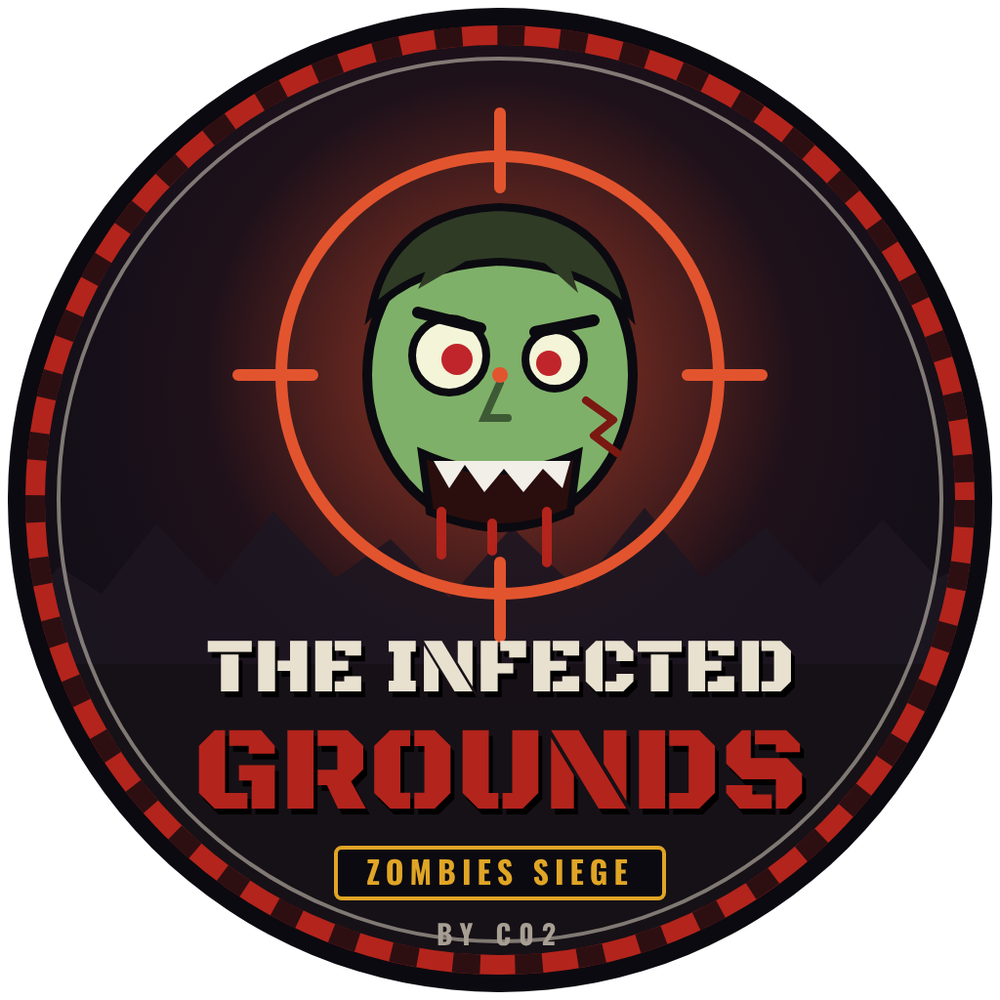

# The Infected Grounds — Zombies Siege

*By C02*

<a href="https://ghoster-001.github.io/Zombie-Survivor-By-C02/"><b>▶ JOUER AU JEU</b></a>

Shooter de survie zombie en vue de côté, jouable dans le navigateur (HTML5 canvas, JavaScript pur, un seul fichier).

## Lancer le jeu
Joue en ligne : https://ghoster-001.github.io/Zombie-Survivor-By-C02/

Ou télécharge le dépôt et ouvre `index.html` dans un navigateur moderne.

## Contenu
- Couteau en arme principale, armes à feu trouvées dans des caisses larguées du ciel (munitions ou durée limitée)
- ~100 armes à débloquer par niveau et par prix, 4 améliorations par arme, skins de couleur
- Zombies de plus en plus forts à chaque vague, vie max améliorable dans le menu
- Personnalisation du personnage : 7 tenues homme / femme (morphologie normale ou exagérée), couleurs de peau, cheveux et vêtements
- Sons synthétisés : chaque arme a son propre son, inspiré de son calibre, de son canon et de son mécanisme (réglage du volume dans Options)
- Musique de fond en boucle (curseur de volume et bouton on/off dans Options)
- 8 bonus lâchés par les zombies : soin, bouclier, dégâts x2, cadence, gel, frappe aérienne, tourelle, butin
- Menu pause (Échap : continuer, paramètres, quitter avec confirmation) ; P fige le jeu sans menu
- Mode Entraînement : toutes les armes au maximum, arme principale au choix, rien n'est sauvegardé
- Deux barres d'XP : niveau de jeu (global) et niveau du personnage (par partie) ; chaque niveau donne un bonus stocké, utilisable à la demande (touche Q)
- Caisses du ciel : tirage au sort uniforme parmi les armes à feu débloquées, le kit de soin et le bouclier
- 25 langues (détection automatique de la langue de l'appareil, changement depuis le menu principal avec les drapeaux)
- Mobile : boutons tactiles (déplacement, saut, tir), toucher sur les caisses et les bonus, écran adapté à toutes les tailles
- Visée souris ou tir dans la direction du déplacement, touches configurables, pause (Échap / P)

Jeu et graphismes originaux, inspirés par le genre des shooters de survie.
